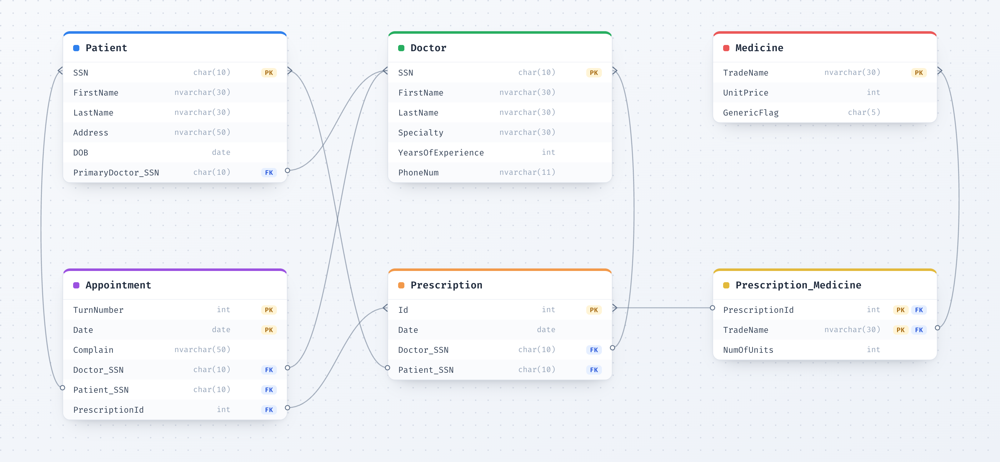

# Prescriptions Database

*Database lab final project &nbsp;·&nbsp; University of Isfahan &nbsp;·&nbsp; Fall 2024*

 

 

A small database for a clinic: doctors, patients, medicines and the prescriptions that connect them, built in SQL Server for Dr. Sara Moeini's database lab. We designed the schema, answered the project's questions with queries, a function and a stored procedure, then added an appointments table and two questions of our own.

<table>
<tr>
<td width="50%"></td>
<td width="50%"></td>
</tr>
</table>

## What we did

| Part | What it covers |
| :-- | :-- |
| **Schema** | Five tables keyed on national IDs, trade names and prescription IDs, with a composite key linking prescriptions to medicines |
| **Reports** | Prescription revenue per year, the three biggest spenders of 1400, and the patients with the most prescriptions |
| **Function and procedure** | `CalculateDrugCount` totals the units prescribed of a drug; `CalculateMaxDrugCount` uses it to find the two most prescribed |
| **Harder queries** | Drugs a patient received from more than one doctor, aspirin's share of prescriptions each year, and the two most similar prescriptions that aren't identical |
| **An update** | Swap clonazepam for diazepam on prescriptions written after a patient was given aspirin |
| **Our extension** | An `Appointment` table, a `PatientsList` function for a doctor's day, and the drugs prescribed for each complaint |

## Files

- [`queries.sql`](queries.sql): every answer, numbered as in the report
- [`report.pdf`](report.pdf): the written report, in Persian, with a screenshot of each result
- [`data/Appointment.xlsx`](data/Appointment.xlsx): sample rows for the `Appointment` table

## Group

- Hosna Soltanolkottabi &nbsp;[@HosnaSltn](https://github.com/HosnaSltn)
- Davoud Nosrati Amirabadi &nbsp;[@ausdavoud](https://github.com/ausdavoud)
